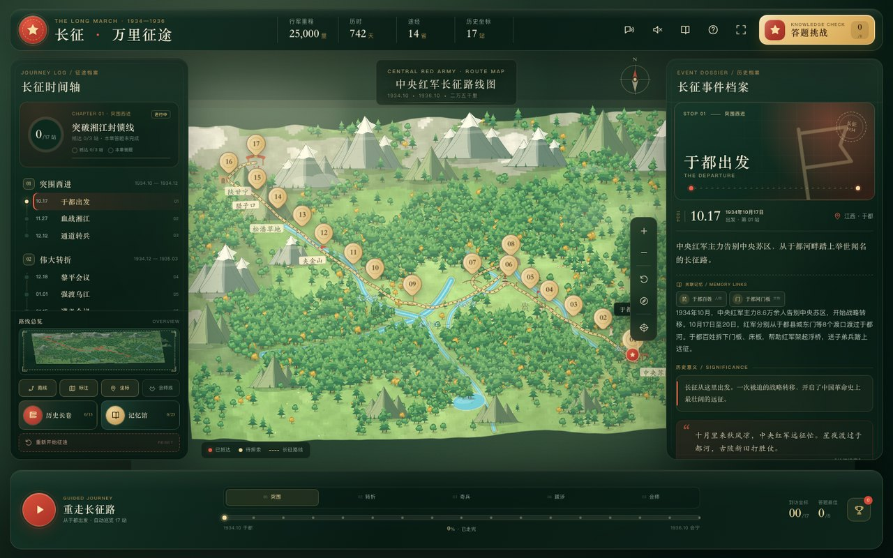
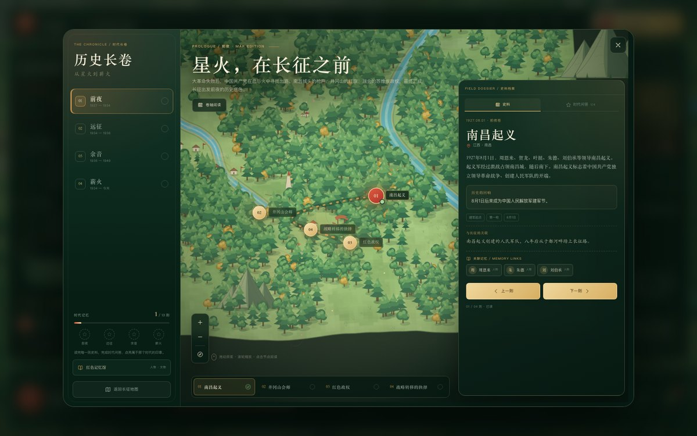
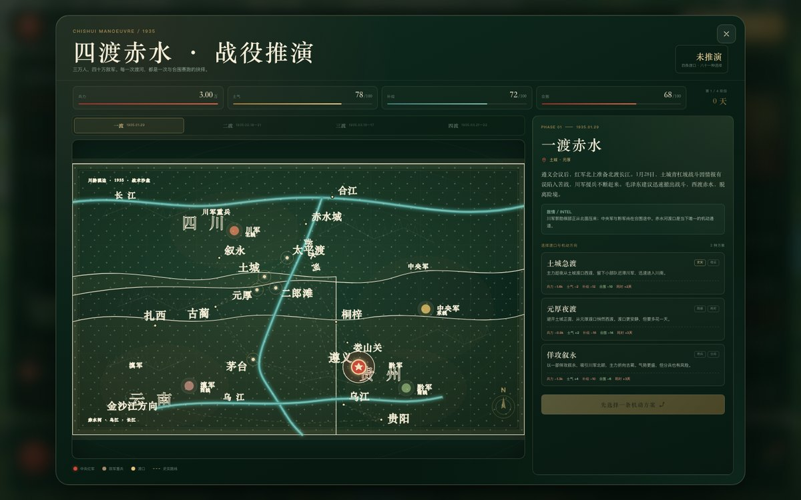
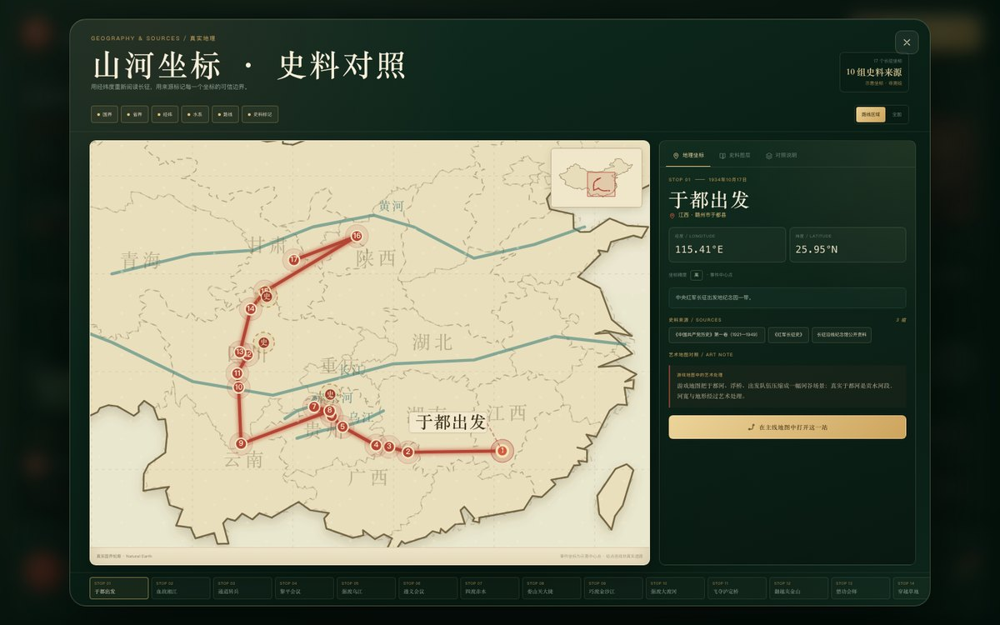
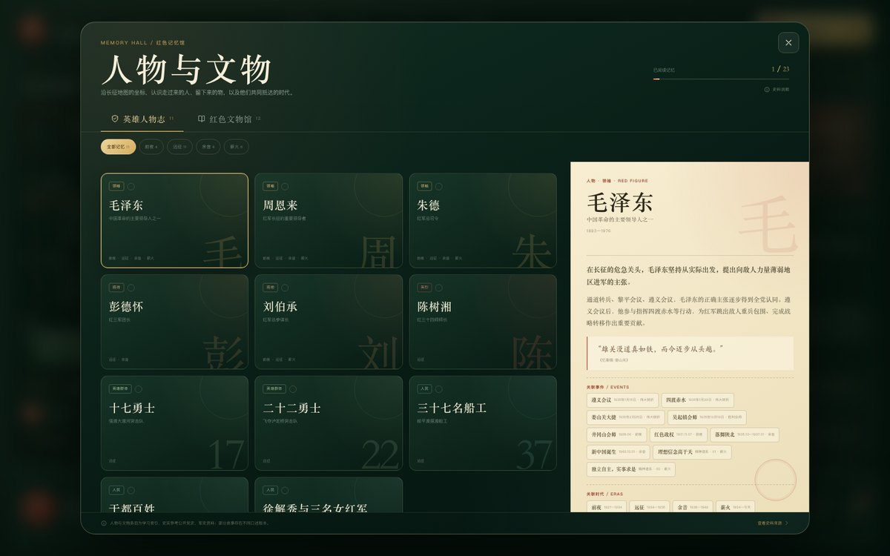
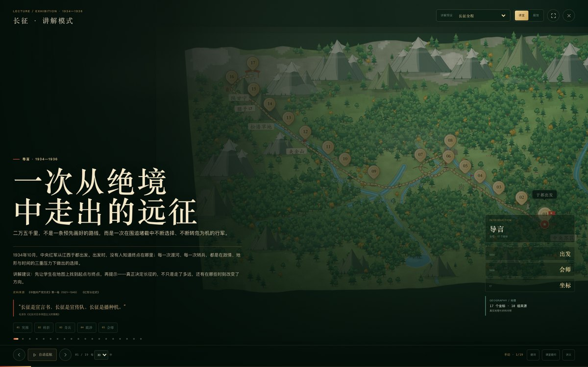
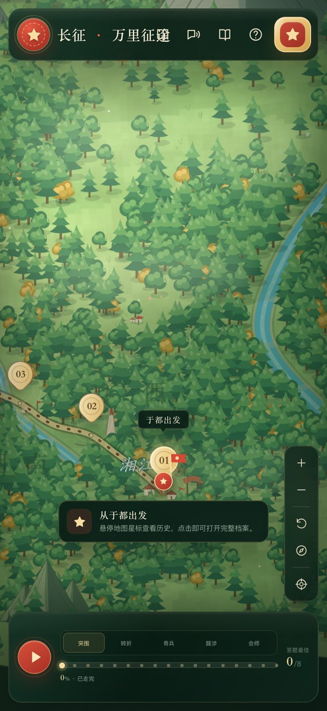

<div align="center">



# 长征 · 万里征途

**重走二万五千里 · 一座可以走进去的长征互动地图**

从江西于都到甘肃会宁，17 个历史坐标、5 个章节、4 卷历史长图、81 种四渡赤水路线。  
可以读，可以走，可以问，也可以带进课堂和展馆。

<p>
  <a href="https://yyy2755.github.io/wanlichagnzheng/"><strong>▶ 在线体验</strong></a>
  &nbsp;·&nbsp;
  <a href="#怎么玩">怎么玩</a>
  &nbsp;·&nbsp;
  <a href="#画面">画面</a>
  &nbsp;·&nbsp;
  <a href="#史料与方法">史料与方法</a>
  &nbsp;·&nbsp;
  <a href="#本地运行">本地运行</a>
</p>

<p>
  
  
  
  
</p>

</div>

> 2026 年，长征胜利 90 周年。  
> 有些历史，不能只停留在年份、路线和考点里。它需要被看见、被走过，也需要被重新问一遍：  
> **为什么出发？为什么转折？为什么能走到最后？**

---

## 这不是一张只用来“看”的地图

长征不是一条被浪漫化的路线。

它是在围追堵截、物资匮乏、雪山草地和无数未知之中，数万人用脚步、判断和牺牲走出来的一条生路。湘江的血战、遵义的选择、赤水的四次往返、泸定桥的铁索、夹金山的雪、草地的沼泽——每一个地名背后，都是具体的人，而不是一个抽象的箭头。

「长征 · 万里征途」想做的，不是把历史变成一套通关游戏，而是先把人带进历史的**空间**：

- 先在地图上看见于都、湘江、遵义、赤水、金沙江、大渡河、雪山草地和陕北；
- 再在时间、人物、文物和史料中，理解每一次选择为什么发生；
- 最后回到今天，问一问：长征精神与我们的生活有什么关系。

游戏里的兵力、补给与合围数值是**推演抽象**，不是战史统计；艺术地图也不是测绘地图。我们尽量让每一个“好玩”的机制，都能落回真实的日期、地点与来源，并在界面上明确标出边界。

**铭记历史，不是记住一个数字，而是理解为什么出发、为什么转折、为什么能走到最后。**

---

## 你可以怎么走

| 入口 | 你会遇见什么 |
| --- | --- |
| **17 站主线** | 从于都出发，经湘江、通道、黎平、乌江、遵义、赤水、娄山关、金沙江、大渡河、泸定桥、夹金山、懋功、草地、腊子口、吴起镇，到会宁会师 |
| **四卷历史长图** | 前夜星火图、远征主路线图、余音山河图、薪火精神星图；每卷都有独立空间与史料 |
| **四渡赤水推演** | 四个阶段、每阶段三种选择、81 种路线；兵力 / 士气 / 补给 / 合围，亲身体验“声东击西” |
| **真实地理与史料** | 17 个真实经纬度、省界水系、全国 / 路线区域双视野，以及每站坐标精度、来源和艺术加工说明 |
| **红色记忆馆** | 11 位人物与英雄群体、12 件文物与旧址；事件—人物—文物—时代互相跳转 |
| **教师 / 展馆讲解** | 章节预设、全屏讲堂、自动巡航、课堂提问、教师提词、HTML 讲义与打印 / PDF |
| **答题与证书** | 8 道主线知识题、章节任务、五枚印章；完成五章任务可生成“长征胜利证书” |

---

## 画面

<table>
  <tr>
    <td width="50%"></td>
    <td width="50%"></td>
  </tr>
  <tr>
    <td align="center"><sub>四卷历史长图：前夜 / 远征 / 余音 / 薪火</sub></td>
    <td align="center"><sub>四渡赤水：81 种路线与敌情推演</sub></td>
  </tr>
  <tr>
    <td width="50%"></td>
    <td width="50%"></td>
  </tr>
  <tr>
    <td align="center"><sub>真实地理与史料：17 个坐标与来源对照</sub></td>
    <td align="center"><sub>红色记忆馆：人物、文物、事件与时代</sub></td>
  </tr>
  <tr>
    <td width="50%"></td>
    <td width="50%"></td>
  </tr>
  <tr>
    <td align="center"><sub>教师 / 展馆讲解：全屏讲堂与课堂提问</sub></td>
    <td align="center"><sub>移动端：地图、档案与时间轴抽屉</sub></td>
  </tr>
</table>

---

## 怎么玩

| 操作 | 效果 |
| --- | --- |
| 悬停地图星标 | 浮出手绘情报卡：时间、地点、事件摘要 |
| 点击星标 / 时间轴 | 镜头飞向坐标，打开右侧历史档案，记录抵达 |
| 拖拽 / 滚轮 / 双指 | 平移、缩放地图 |
| 底部「重走长征路」 / `Space` | 自动巡览 17 站 |
| 顶部「答题挑战」 / `Q` | 8 道长征知识题，答错也会给出历史讲解 |
| 顶部语音按钮 / `N` | 自动语音讲解 + 字幕 |
| 历史长卷 / `L` | 打开四个时代的独立地图与卷轴阅读 |
| 红色记忆馆 / `M` | 打开人物志与文物馆 |
| 真实地理 / `G` | 打开山河坐标 · 史料对照 |
| 讲解模式 / `P` | 打开教师 / 展馆讲堂 |
| `←` / `→` | 上一站 / 下一站 |
| `R` | 路线全览 |
| `F` | 跟随红军当前站点 |
| `?` | 玩法说明 |

进度、章节印章、长卷阅读、记忆馆阅读、答题最佳成绩与语音偏好保存在浏览器 `localStorage`；不使用账号，不上传个人数据。

---

## 完整内容

<details>
<summary><strong>17 个历史坐标与五章任务</strong></summary>

17 个坐标：于都出发、血战湘江、通道转兵、黎平会议、强渡乌江、遵义会议、四渡赤水、娄山关大捷、巧渡金沙江、强渡大渡河、飞夺泸定桥、翻越夹金山、懋功会师、穿越草地、突破腊子口、吴起镇会师、会宁会师。

每一站包含日期、地点、摘要、完整故事、历史意义、关键数字、历史引文与标签。五个章节各有任务与印章：

- **突围西进**：告别苏区，血战湘江。
- **伟大转折**：通道、黎平、遵义、赤水、娄山关。
- **奇兵迭出**：金沙江、大渡河、泸定桥。
- **艰难跋涉**：夹金山、懋功、草地、腊子口。
- **胜利会师**：吴起镇、会宁。

完成五章任务后解锁“长征胜利证书”，可保存为 PNG 或调用系统分享。

</details>

<details>
<summary><strong>四卷历史长图</strong></summary>

「历史长卷」把长征放进更长的历史脉络里：

- **前夜 1927—1934**：南昌起义、井冈山会师、红色政权、第五次反“围剿”失利与战略转移。
- **远征 1934—1936**：串联五章长征主线，可一键返回地图、进入章节或查看胜利证书。
- **余音 1936—1949**：落脚陕北、全民族抗战、解放战争、新中国诞生。
- **薪火 1934—今天**：理想信念、不怕牺牲、实事求是、顾全大局、依靠人民。

四卷各有独立地图语言：星火图、主路线图、全国山河图、精神星图；同时保留“卷轴阅读”视角。共 13 则史料、3 道时代问答与 4 枚时代印章。

</details>

<details>
<summary><strong>四渡赤水 · 战役推演</strong></summary>

从赤水事件档案进入：

- 一渡、二渡、三渡、四渡赤水，每阶段三种渡口 / 机动方案，共 81 种路线组合。
- 兵力、士气、补给、合围四组数值；合围值越低越好。
- 川军、中央军、黔军、滇军会随选择移动。
- 每次机动有历史注解，结算时与史实路线对照。
- S / A / B / C / D 评价、五星、最佳成绩与「赤水奇谋」徽章。
- 推演数值为游戏抽象，不对应具体战史统计。

</details>

<details>
<summary><strong>真实地理与史料图层</strong></summary>

从顶栏地图图标或 `G` 进入「山河坐标 · 史料对照」：

- **路线区域 / 全国** 双视野；中国缩略图定位。
- Natural Earth 国界轮廓、DataV 省界、黄河 / 长江 / 赤水河 / 乌江、经纬网与省名。
- 17 个站点的真实中心坐标、现代行政区、坐标精度与艺术加工说明。
- 每条坐标关联 1—3 组来源；「地理坐标 / 史料图层 / 对照说明」三栏切换。
- 国界、省界、经纬、水系、路线、史料标记可独立开关。
- 可一键回到主线地图的对应事件档案。

事件坐标为学习用中心点，精确到 0.01°；不是战场边界或测绘坐标。省界、河流与站点连线均为示意。

</details>

<details>
<summary><strong>红色记忆馆</strong></summary>

- **英雄人物志**：11 条人物与英雄群体，包括毛泽东、周恩来、朱德、彭德怀、刘伯承、陈树湘、十七勇士、二十二勇士、三十七名船工、于都百姓、徐解秀与三名女红军。
- **红色文物馆**：12 条文物与旧址，包括于都河门板、半条被子、朱德的扁担、中华苏维埃共和国印章、遵义会议会址、赤水河渡船、皎平渡木船、泸定桥铁索、雪山草鞋、半截皮带、会师红旗、延安窑洞油灯。

人物、文物与事件、时代地图双向跳转；阅读进度累计为「记忆馆 0/23」，全部读完后解锁「记忆守护者」徽章。

</details>

<details>
<summary><strong>教师 / 展馆讲解模式</strong></summary>

从顶栏讲台图标或 `P` 进入全屏讲堂：

- **课堂模式**：大字标题、教师提词、章节数据、真实坐标；支持自动巡航与课堂提问。
- **展馆模式**：隐藏提词和教师工具，标题、导语与引文居中放大，自动循环，适合大屏。
- **章节预设**：全程、突围、转折、奇兵、跋涉、会师，以及「山河坐标」「精神传承」主题。
- **自动巡航**：20 / 30 / 45 秒三档，带进度条；课堂模式到末页停止，展馆模式循环。
- **课堂提问**：每站一题，选项作答、揭晓答案与解析；提问时自动暂停巡航。
- **讲义导出**：下载当前预设的完整 HTML 讲义，或打印 / 另存 PDF。
- 讲解模式不会写入个人到访进度；退出后恢复原来的站点与地图视野。

示例讲义：[lecture-handout-sample.html](lecture-handout-sample.html)

</details>

<details>
<summary><strong>语音、答题与徽章</strong></summary>

- 语音讲解使用 Web Speech API，中文系统语音 + 分段字幕；无外部音频依赖。
- 8 道主线知识题；每章设有指定题目，答对并抵达全部站点即可获得章节印章。
- 徽章覆盖抵达、答题、长卷阅读、记忆馆、四渡赤水推演等里程碑。
- 进度保存在浏览器本地；「重新开始征途」可选择是否同时清空答题最佳成绩。

</details>

---

## 适合谁

- **学生**：先在地图上建立空间感，再通过人物、文物与问题理解历史。
- **教师**：用章节预设、讲解提词、课堂提问和讲义，把一次参观变成一堂可组织的课。
- **展馆 / 博物馆**：用展馆模式做大屏循环展示，用真实地理与史料图层做背景板。
- **家长与普通玩家**：不需要历史基础，也可以从一次点击、一条路线开始读下去。

---

## 史料与方法

这个项目尽量把“历史叙述”和“游戏表达”分开标注：

- 主线事件、日期、人物与战役过程参考《中国共产党历史》第一卷、《中国工农红军长征史》《红军长征史》《毛泽东诗词集》及长征沿线纪念馆公开资料。
- 人物与文物中的部分故事来自口述史，存在不同版本；界面中以概括性叙述呈现。
- 真实地理图层使用 Natural Earth 1:50m Admin 0 – Countries 公有领域国界轮廓，省界参考高德 DataV 公开行政区划数据，经简化、投影与淡化处理。
- 事件坐标取会议、战斗或纪念地的常用中心点，精确到 0.01°；不是战场边界或测绘坐标。
- 省界、河流、路线连线为学习示意；不作为边界主张或测绘依据。
- 游戏中的兵力、补给、合围、评分等是叙事与推演抽象，不对应具体战史统计。

完整来源可在游戏内「玩法说明 → 史料来源」与「真实地理 → 史料图层」查看。

---

## 技术

- **原生 HTML / CSS / JavaScript**，零第三方运行时依赖，无构建步骤。
- **Canvas 2D** 程序化手绘地图：高度场、雪峰、森林、河流、梯田、村舍、关隘、铁索桥与草地。
- **离屏预渲染 + 分层绘制**：主地图、全国态势图、星图与动态粒子兼顾精致度与移动端性能。
- **SVG**：四渡赤水战术沙盘、真实地理纸本地图、教师讲堂与图标系统。
- **Web Speech API**：中文语音讲解、字幕与自动巡览联动。
- **localStorage**：到访、章节、答题、长卷、记忆馆与推演最佳成绩。
- **Blob + 打印样式**：教师讲义 HTML 下载与打印 / PDF。
- **响应式 HMI**：桌面三栏控制台，移动端抽屉式档案与时间轴。
- **无障碍**：键盘快捷键、ARIA 标记、减少动效偏好支持。

---

## 本地运行

```bash
git clone https://github.com/yyy2755/wanlichagnzheng.git
cd wanlichagnzheng
open index.html
```

或者：

```bash
python3 -m http.server 8765
# 打开 http://127.0.0.1:8765/
```

项目也支持直接双击 `index.html`，通过 `file://` 打开；语音功能是否需要网络取决于浏览器与系统语音。

---

## 项目结构

```text
.
├── index.html                  # 游戏主页面
├── css/
│   └── style.css               # HMI、地图、长卷、记忆馆、推演、地理、讲堂
├── js/
│   ├── data.js                 # 17 站、长卷、人物文物、推演、地理、讲解数据
│   ├── map.js                  # 主地图 Canvas 引擎
│   ├── chronicle-map.js        # 四卷长图引擎
│   ├── geoatlas.js             # 真实地理与史料图层
│   ├── geo-provinces.js        # 简化省界数据
│   ├── tactical.js             # 四渡赤水推演
│   ├── lecture.js              # 教师 / 展馆讲解
│   └── app.js                  # 应用状态与界面编排
├── docs/screenshots/           # README 与分享图
├── lecture-handout-sample.html # 示例教师讲义
└── preview*.png                # 原始预览图
```

---

## 使用与致谢

欢迎用于**课堂教学、公益展陈与个人学习**。转载、改编或再发布时，请注明「长征 · 万里征途」及本仓库地址；未经授权请勿用于商业用途。

感谢所有公开党史、军史资料与纪念馆展陈资料的研究者、整理者与讲述者。  
也感谢每一个愿意在地图前多停留一会儿、把这段历史继续讲下去的人。

<div align="center">

**长征永远在路上。**

[在线体验](https://yyy2755.github.io/wanlichagnzheng/) · [提交问题](https://github.com/yyy2755/wanlichagnzheng/issues) · [仓库主页](https://github.com/yyy2755/wanlichagnzheng)

</div>
